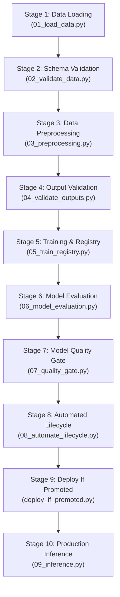

# Lab 7: Production End-to-End MLOps Pipeline Report

## 1. Executive Summary

Lab 7 establishes an automated, production-grade Machine Learning Operations (MLOps) pipeline for the **Telco Customer Churn Prediction** system. The pipeline integrates data ingestion, strict schema enforcement, data preprocessing, output validation, model training, MLflow tracking, automated model registry management, quality gates, conditional deployment, and batch inference.

---

## 2. Pipeline Architecture & Modular Components

The pipeline is organized into 10 discrete, reproducible stages orchestrated by `src/mlops_pipeline/churn_prediction_pipeline.py`:



### Stage Details:
1. **Data Ingestion (`01_load_data.py`)**: Detects new data batches (`data/raw/new_churn.csv`), validates batch identity, checks SHA256 hashes against history, archives prior datasets to `data/raw/archive/churn_v*.csv`, appends non-overlapping records, and outputs `artifacts/data_load_report.json`.
2. **Raw Data Validation (`02_validate_data.py`)**: Validates schema compliance using `pandera.DataFrameSchema`. Enforces non-negative tenure, valid categorical domains, string/null handling for `TotalCharges`, and non-negative float values for `MonthlyCharges`.
3. **Data Preprocessing (`03_preprocessing.py`)**: Executes deterministic, leakage-free train/test splitting with persistent test IDs (`test_customer_ids.csv`). Fits a `ColumnTransformer` (`StandardScaler` + `SimpleImputer` on numericals, `OneHotEncoder(drop='first')` on categoricals). Saves matrices to `data/processed/` and serializes `models/preprocessor.pkl`.
4. **Processed Output Validation (`04_validate_outputs.py`)**: Asserts absence of NaNs, feature and dimensional parity between train/test matrices, and saves `artifacts/preprocessing_summary_report.json`.
5. **Model Training & Registry (`05_train_registry.py`)**: Fits a balanced `RandomForestClassifier` (`n_estimators=150`, `max_depth=12`, `random_state=42`, `class_weight=balanced`). Logs run metrics and hyperparameters to MLflow (`sqlite:///mlflow.db`) and registers the model under `CustomerChurnClassifier`.
6. **Model Evaluation (`06_model_evaluation.py`)**: Evaluates predictions on the fixed test split, computing Accuracy, Precision, Recall, F1-Score, ROC-AUC, and Confusion Matrix. Outputs `reports/evaluation_report.json`.
7. **Model Quality Gate (`07_quality_gate.py`)**: Applies an automated gate asserting $\text{Recall} \ge 0.70$. Prevents promotion if criteria are unmet, outputting `reports/quality_gate_report.json`.
8. **Automated Lifecycle Management (`08_automate_lifecycle.py`)**: Transitions newly registered versions to `Staging`. Compares Staging candidate decision metric against the active `Production` model. Promotes superior models to `Production` and archives champions that are superseded.
9. **Deploy If Promoted (`deploy_if_promoted.py`)**: Checks the lifecycle outcome. If promoted, triggers deployment packaging; if not promoted, records the non-promotion status cleanly without halting.
10. **Production Inference (`09_inference.py`)**: Pulls the active model directly from MLflow Model Registry (`models:/CustomerChurnClassifier/Production`), transforms sample inputs, generates predictions and churn probabilities, and saves `outputs/inference_predictions.csv`.

---

## 3. Actual Execution Metrics & Outputs

Evaluated on the fixed held-out test split:
- **Accuracy**: 0.7740
- **Precision**: 0.5490
- **Recall**: 0.8148
- **F1-Score**: 0.6560
- **ROC-AUC**: 0.8653

**Confusion Matrix:**
```
[[798, 253],
 [ 70, 308]]
```

**Quality Gate Verification:**
- Metric: `recall`
- Minimum Threshold: 0.7000
- Evaluated Score: 0.8148
- Gate Status: **PASSED**

---

## 4. Execution Commands

From the target project root `C:\MLOPS\Churn_Prediction-241FA18343`:

```powershell
# Execute the complete end-to-end pipeline:
& "C:\MLOPS\.venv\Scripts\python.exe" src\mlops_pipeline\churn_prediction_pipeline.py --force

# Verify pipeline run log:
Get-Content logs\churn_prediction_pipeline_run_log.json
```
